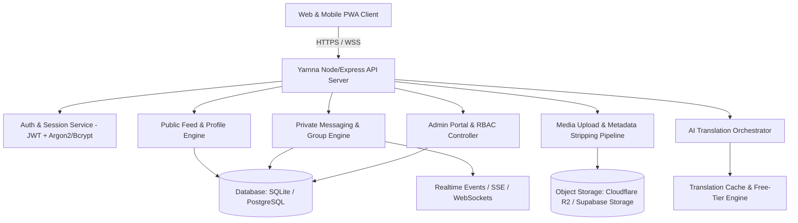

# Yarnna Architecture and Zero-Budget Strategy Specification

## 1. Executive Summary and Product Identity

Yarnna is a Nigeria-first, privacy-conscious social networking platform designed for text posts, photo sharing, and private messaging. The platform combines the public conversation dynamics of microblogging with the familiarity and privacy of direct messaging and group chats.

### Core Pillars
1. **Familiarity**: Combining public discussions (threads, reposts, discovery) with private messaging (one-to-one chats, group chats, voice notes, photo sharing).
2. **Privacy First**: Private messages, voice notes, and group chats are strictly separated from public feeds at the database, storage, and API levels. Administrative staff have no routine access to private message contents.
3. **Bandwidth and Resource Efficiency**: Optimized for Nigerian network realities (2G/3G/4G bandwidth constraints, mobile data costs) with client-side image compression, metadata stripping, lazy loading, and lightweight payloads.
4. **Zero Budget Testnet**: Fully architected to operate within verified, sustainable free-tier infrastructure allowances during its experimental testnet phase, with strict quota caps, graceful degradation, and no unexpected cloud bills.
5. **No Video Scope**: In this release phase, Yarnna does not support video uploads, video feeds, voice calls, or video calls. Buttons or controls for video are intentionally excluded.

---

## 2. System Architecture

### 2.1 Backend Separation of Concerns
- **Public Domain**: Posts, comments, threaded replies, likes, reposts, bookmarks, follows, user profiles, public search.
- **Private Domain**: One-to-one chats, group conversations, group memberships, direct messages, voice note attachments, chat photos, delivery receipts, typing indicators.
- **Moderation and Administrative Domain**: Separate endpoints protected by role-based access control (RBAC), multi-factor authentication (MFA) confirmation, strict audit logs, and anonymized aggregate reporting.

---

## 3. Verified Free-Tier Infrastructure Strategy

To maintain a true zero-budget operation during the testnet phase, Yarnna utilizes verified cloud free allowances with automatic quota guardrails:

| Component | Recommended Provider | Verified Free-Tier Allowance | Quota Exhaustion Guardrail |
| :--- | :--- | :--- | :--- |
| **Compute & API** | Render / Fly.io / Railway / Vercel Serverless | 750 free instance hours / month (Render) or 100k edge requests / day (Cloudflare Pages/Workers) | Auto-sleep on inactivity; queue rate limiting |
| **Relational Database** | Supabase (PostgreSQL) / Neon / Turso | 500 MB database storage, 2 active projects, 50k monthly active users (Supabase) | Hard cap alerts at 400 MB; automated payload pruning |
| **Object Storage** | Cloudflare R2 / Supabase Storage | 10 GB free storage, 10 million Class B read operations, 1 million Class A write operations, $0 egress fees | Upload cap at 1.5 MB per image and 2 MB per voice note |
| **Realtime Messaging** | Server-Sent Events (SSE) / Supabase Realtime | 200 concurrent connections, 2 million realtime messages / month | Fallback to intelligent exponential polling (2s-15s) |
| **Translation Engine** | Hugging Face Free Inference API / Local Edge Dict Cache | 30k free tokens / month; local phrasebook for common Pidgin/Yoruba/Igbo/Hausa expressions | Caching layer for popular phrases; gracefully disabled when quota is reached |

---

## 4. Operating Cost Projections

Detailed operating cost projections across four growth milestones:

| Category | 100 MAU (Testnet Seed) | 1,000 MAU (Alpha Community) | 5,000 MAU (Beta Launch) | 10,000 MAU (Public Testnet Cap) |
| :--- | :--- | :--- | :--- | :--- |
| **Database Storage** | ~15 MB ($0.00) | ~120 MB ($0.00) | ~450 MB ($0.00 within Supabase) | ~900 MB ($25.00/mo or self-hosted) |
| **Media Storage (R2)** | ~250 MB ($0.00) | ~2.5 GB ($0.00) | ~12 GB ($0.30/mo) | ~25 GB ($0.60/mo) |
| **Egress / Transfer** | Zero cost via Cloudflare R2 | Zero cost via Cloudflare R2 | Zero cost via Cloudflare R2 | Zero cost via Cloudflare R2 |
| **Compute / API Server** | Free Tier ($0.00) | Free Tier ($0.00) | $7.00/mo (Basic VPS / Render) | $15.00/mo (VPS / Render) |
| **Realtime Events** | Free Tier ($0.00) | Free Tier ($0.00) | Free Tier ($0.00) | $10.00/mo |
| **Translation Requests** | Free Tier ($0.00) | Free Tier ($0.00) | ~$3.00/mo | ~$6.00/mo |
| **Monitoring & Logs** | Free Tier ($0.00) | Free Tier ($0.00) | Free Tier ($0.00) | Free Tier ($0.00) |
| **Total Monthly Cost** | **₦0.00 ($0.00)** | **₦0.00 ($0.00)** | **~$10.30 (~₦16,500)** | **~$56.60 (~₦90,500)** |

*Note: In the initial testnet phase (100 to 1,000 MAU), Yarnna operates at exactly $0.00 out-of-pocket cost.*

---

## 5. Media Ingestion and Bandwidth Optimization

1. **Client-side Image Optimization**:
   - Resized to maximum 1600px width/height before upload.
   - Converted to modern WebP / JPEG format with quality 0.82.
   - EXIF and GPS geolocation metadata stripped completely in browser memory using HTML5 Canvas / ArrayBuffer before binary transmission.
2. **Server-side Validation**:
   - Magic byte header inspection (validates actual binary image/audio signature, rejecting disguised executables).
   - Maximum photo size: 2.5 MB.
   - Maximum voice note size: 2.0 MB (maximum duration: 120 seconds).
   - Supported photo formats: `image/jpeg`, `image/png`, `image/webp`.
   - Supported voice note formats: `audio/webm`, `audio/ogg`, `audio/mp4`, `audio/mpeg`.
3. **No Video Principle**:
   - All video file extensions and MIME types (`video/mp4`, `video/webm`, `video/quicktime`, etc.) are explicitly rejected with code 415 and a friendly error message: "Video uploads are not supported on Yarnna during testnet."

---

## 6. Language and Localization Strategy

Yarnna supports five primary Nigerian linguistic contexts:
1. **English** (Standard Nigerian English)
2. **Nigerian Pidgin** (Naija)
3. **Yoruba**
4. **Igbo**
5. **Hausa**

### Translation Rules:
- Translation is strictly optional and user-triggered via an explicit "Translate" button.
- The original text is always visible and never replaced.
- Translated text is labeled clearly with a badge indicating the target language.
- Private messages are never forwarded to external translation APIs automatically.
- A built-in phrasebook covers colloquial Nigerian idioms and greetings without external API calls.
