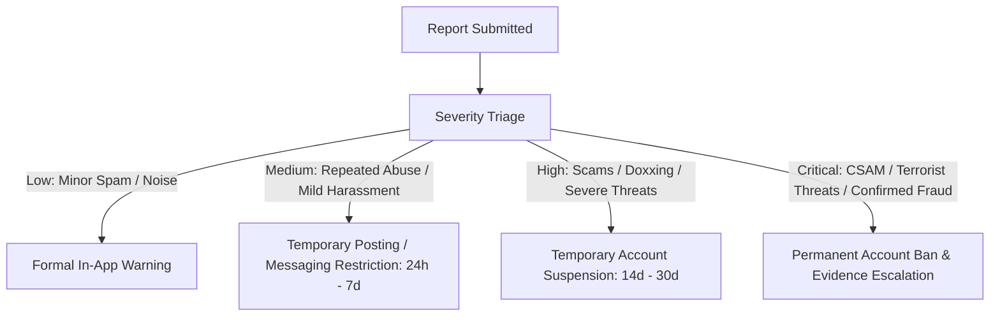

# Yarnna Community Guidelines and Moderation Policy

## 1. Guiding Philosophy: Welcoming, Respectful, and Safe

Yarnna is built for Nigerians and friends of Nigeria to connect, converse, share photos, and build authentic relationships. We believe in open dialogue, creative expression, and lively debate, while maintaining uncompromising safety standards that protect community members from abuse, fraud, and illegal harm.

---

## 2. Prohibited Content and Conduct

### 2.1 Harassment and Targeted Abuse
- Repeatedly sending unwanted private messages after being asked to stop or blocked.
- Coordinated pile-ons or encouraging other accounts to attack an individual.
- Slurs or degrading attacks targeting ethnicity, religion, gender, or disability.

### 2.2 Threats and Violence
- Direct threats of physical harm, kidnapping, extortion, or property destruction.
- Glorification or promotion of violent organizations or terrorist activities.

### 2.3 Scams, Fraud, and Financial Manipulation
- "Ponzi schemes", fake crypto giveaways, or fraudulent investment solicitations.
- Phishing links designed to steal banking tokens, BVNs, or account credentials.
- Impersonation of financial institutions, government agencies, or notable figures.

### 2.4 Child Protection and Exploitation (Zero Tolerance)
- Any depiction, facilitation, or solicitation of child sexual abuse material (CSAM) or grooming behaviors.
- Accounts engaging in child exploitation will be permanently banned immediately, with digital evidence preserved and escalated to Nigerian law enforcement agencies (NDPC, NAPTIP, Nigeria Police Force).

### 2.5 Doxxing and Non-Consensual Personal Information
- Publishing private phone numbers, home addresses, National Identity Numbers (NIN), BVN numbers, or private communications without explicit consent.

### 2.6 Spam and Automated Manipulation
- Scripted account creation, artificial like farming, or flood-posting duplicate messages.

### 2.7 Protection for Lawful Criticism
- Lawful criticism, critique, satire, or grievances regarding Yarnna, its platform features, its policies, or its administrators are strictly protected. Moderators are prohibited from taking punitive action against accounts solely for expressing unfavorable opinions about the platform.

---

## 3. Moderation Actions and Proportional Enforcement

Moderators must apply the least restrictive intervention necessary to restore community safety:

### Action Levels:
1. **Notice / Warning**: In-app advisory informing the user of the violated policy without restricting core functionality.
2. **Posting or Messaging Restriction**: Temporary limitation preventing the creation of new public posts or initiating new direct conversations for a specified duration (24 hours to 7 days).
3. **Account Suspension**: Temporary inability to log in or interact with the platform (14 to 30 days).
4. **Permanent Ban**: Complete revocation of access. Requires justification and secondary moderator sign-off.

---

## 4. Appeals Process

Any user subjected to a restriction, suspension, or post removal has the right to submit a formal appeal through their Account Status menu:
1. The appeal must state the justification and any relevant context.
2. Appeals are reviewed by an independent safety officer who was not involved in the original moderation decision.
3. Decisions are resolved within 72 hours, with written explanation provided in the user's notification center.
