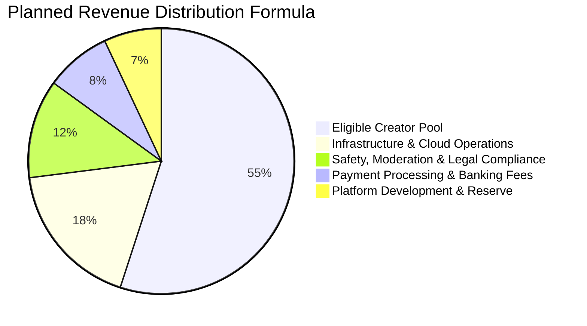

# Yarnna Future Creator Revenue Sharing Specification

## 1. Testnet Phase Disclaimer and Notice

> [!IMPORTANT]
> **Yarnna is currently in its experimental testnet phase.**
> 
> Yarnna operates with **zero advertising and zero creator revenue payouts** during this testnet stage. The specifications below define the planned business and mathematical model for future phases, which will be activated only after formal approval by the project owner and completion of all legal, tax, privacy, and regulatory assessments. No earnings or payouts are guaranteed or simulated during testnet.

---

## 2. Guiding Philosophy: Fair Micro-Earnings (₦1 Feasibility)

The guiding principle of Yarnna is that **every eligible creator should have a fair opportunity to earn, even when the individual amount is as small as ₦1, where legally and operationally feasible.**

Unlike conventional platforms with prohibitive follower gates that exclude everyday users, Yarnna's model is designed to recognize and reward authentic community contributions at all scales, while strictly protecting against fraud, manipulation, and insolvency.

---

## 3. Revenue Allocation Model (Future Monetization Phase)

When approved revenue sources (such as non-intrusive contextual ads, verified community badges, and creator tipping) are introduced, gross revenue will be partitioned according to a transparent formula:

### Allocation Breakdown:
1. **Creator Payout Pool (55%)**: Directly allocated to eligible creators based on auditable community engagement metrics.
2. **Infrastructure and Cloud Operations (18%)**: Covers database compute, object storage, bandwidth, and AI translation costs.
3. **Safety, Moderation and Legal Compliance (12%)**: Dedicated fund for human content moderation, child protection reporting, and NDPC compliance audits.
4. **Payment Gateway and Transfer Fees (8%)**: Covers NIP (NIBSS Instant Payment), Paystack/Flutterwave/Monnify settlement fees.
5. **Platform Reserve and Maintenance (7%)**: Emergency buffer and system expansion fund.

---

## 4. Creator Eligibility and Anti-Fraud Guardrails

To prevent bot manipulation, click farming, and sybil abuse, accounts must satisfy strict organic criteria:

### 4.1 Eligibility Criteria:
- Account active for at least 30 consecutive days.
- Acknowledged the testnet and community safety notices.
- Verified unique phone number or email address.
- Zero unresolved moderation strikes (harassment, spam, scam reports) in the preceding 60 days.
- Must not engage in coordinated engagement groups or automated engagement loops.

### 4.2 Anti-Fraud & Sybil Defense:
- **Engagement Weighting**: Likes and replies from newly created accounts or accounts with zero activity are filtered out.
- **Velocity Checks**: Sudden bursts of unnatural engagement trigger automated auditing.
- **Duplicate Content Filter**: Reposting the same text or photos across accounts disqualifies all involved accounts from the revenue pool for that cycle.

---

## 5. Micro-Earnings Ledger and Payout Logistics

In Nigeria, individual NIP interbank transfers carry fixed transaction charges (₦10 to ₦50 per transfer depending on the provider). Attempting to disburse an instant ₦1 bank transfer would incur a fee higher than the payout itself.

### The Two-Tier Solution:
1. **Accurate Internal Micro-Ledger (Precision to ₦0.01)**:
   - Every eligible post records creator points that convert directly to Naira.
   - If a creator earns ₦1.45, that exact amount is credited to their Yarnna Creator Ledger in real time.
   - Creators can view their exact balance, calculation formula, and post-by-post breakdown transparently.
2. **Threshold-Based Bank Settlement**:
   - Ledger balances remain securely accrued with zero expiration.
   - Payout to a Nigerian bank account or mobile money wallet is initiated automatically once the balance crosses ₦500 (to ensure bank transfer fees do not erode earnings), or via accumulated monthly batches.
   - Alternatively, micro-balances below ₦500 can be used within Yarnna for platform badges or creator tipping without incurring third-party bank fees.

---

## 6. Taxation and Financial Reporting

- **Withholding Tax (WHT)**: All disbursements adhere to Nigerian Federal Inland Revenue Service (FIRS) and state internal revenue service regulations.
- **Auditable Statements**: Creators will receive a downloadable monthly PDF statement detailing impressions, verified engagements, gross revenue share, deductions, and net disbursements.
