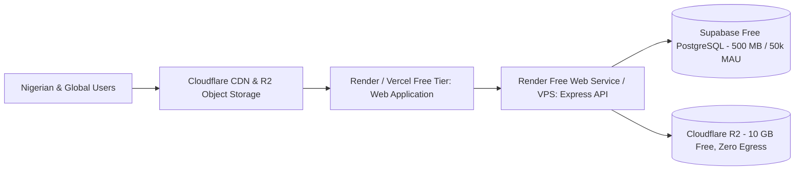

# Yarnna Deployment, Backup & Recovery, and Incident Response Guide

## 1. Zero-Budget Deployment Architecture

Yarnna is architected for zero-cost deployment across verified cloud free tiers during its testnet phase:



### 1.1 Prerequisites
- Node.js v20+ or v24+
- Git repository
- Free Cloudflare account (for DNS, SSL, and R2 Object Storage)
- Free Supabase account (for PostgreSQL database)

---

## 2. Production Deployment Runbook

### Step 1: Environment Provisioning
Copy the `.env.example` template and populate verified production values:
```bash
cp .env.example .env
```
Key production configurations:
- Set `NODE_ENV=production`
- Configure a cryptographically secure 64-character `JWT_SECRET`
- Provide your Supabase PostgreSQL connection string via `DATABASE_URL`
- Configure Cloudflare R2 bucket credentials for media storage

### Step 2: Database Migration
Execute the PostgreSQL schema and Row Level Security policies:
```bash
# Apply schema directly via psql or Supabase SQL Editor
psql "$DATABASE_URL" -f database_schema_and_rls.sql
```
Verify that Row Level Security is active on all tables:
```sql
SELECT tablename, rowsecurity FROM pg_tables WHERE schemaname = 'public';
```

### Step 3: Frontend Asset Compilation
Compile the React application into optimized static assets:
```bash
npm run build
```
This generates the minified production bundle in `dist/`.

### Step 4: Service Startup
Launch the Express application:
```bash
npm start
```
The server will bind to `0.0.0.0:3001` (or your configured `PORT`), serving both API endpoints and the frontend single-page application with security headers.

---

## 3. Automated Backup and Disaster Recovery

### 3.1 PostgreSQL Database Backups
1. **Automated Daily Snapshots**: Supabase provides automated daily backups on free tier with 7-day retention.
2. **Independent Logical Dumps**: Schedule a daily cron job exporting schema and data:
   ```bash
   pg_dump --format=custom --no-owner --no-privileges "$DATABASE_URL" > "yarnna_backup_$(date +%Y%m%d).dump"
   ```
3. **Backup Encryption**: Encrypt backup dumps using AES-256 before uploading to cold storage.

### 3.2 Media Object Storage Replication
- Photos and voice notes stored in Cloudflare R2 benefit from 99.999999999% (11 9s) durability across geographically distributed storage nodes.
- Egress is $0.00, enabling cost-free synchronization to local cold storage using `rclone`:
   ```bash
   rclone sync r2:yarnna-media ./cold_storage_media
   ```

### 3.3 Recovery Time Objective (RTO) and Recovery Point Objective (RPO)
- **RTO**: Under 30 minutes to spin up a replacement compute node.
- **RPO**: Maximum 24 hours (nightly automated snapshot) or under 1 hour with WAL archiving.

---

## 4. Security Incident Response Protocol

### 4.1 Severity Classification
- **P0 (Critical)**: Active cross-user data leakage, authentication bypass, remote code execution, or CSAM distribution.
- **P1 (High)**: Administrator account compromise, denial-of-service, or localized rate limit bypass.
- **P2 (Medium)**: Non-impacting bug or isolated spam burst.

### 4.2 Triage and Containment Steps
1. **Immediate Isolation**: Revoke compromised admin JWT tokens by rotating signing secrets in environment variables.
2. **Access Lockdown**: Trigger emergency read-only mode if data tampering is suspected.
3. **Evidence Preservation**: Export immutable audit logs (`admin_audit_logs`) and application access logs for forensic analysis.
4. **Remediation & Patching**: Apply targeted fix, run the 29 automated test gates, and deploy hotfix.
5. **Regulatory Disclosure**: If personal data of Nigerian citizens is affected, notify the Nigeria Data Protection Commission (NDPC) within 72 hours in compliance with Section 40 of the NDPA 2023.

---

## 5. Vulnerability Disclosure Policy
Security researchers can report findings responsibly to `security@yarnna.ng`. We pledge not to initiate legal action against researchers acting in good faith who avoid privacy violations and service degradation.
